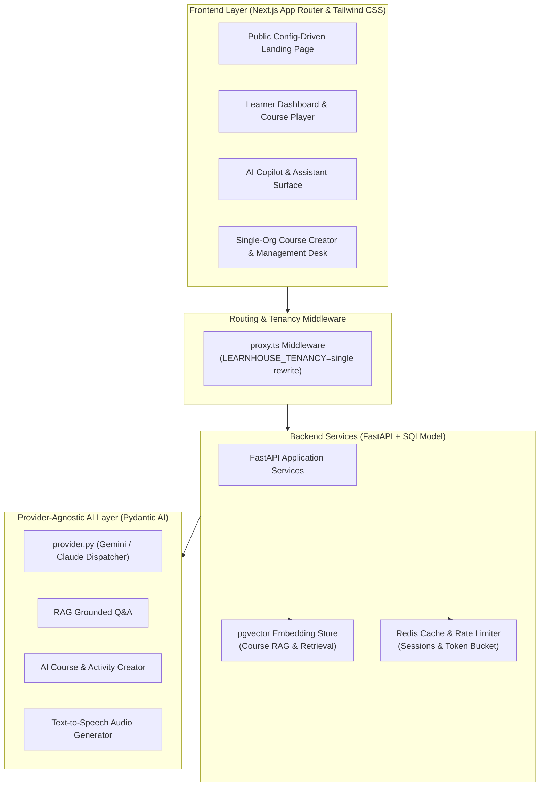

# Prabodh

<p align="center">
  <strong>Enterprise Learning Management Platform & Multi-Provider AI Architecture</strong><br>
  <em>White-labelled single-tenant LMS based on LearnHouse (AGPL-3.0), featuring FastAPI backend services, pgvector semantic search, Next.js App Router frontend, and Google Gemini / Claude AI copilot.</em>
</p>

<p align="center">
  
  
  
  
  
  
</p>

---

## Overview

**Prabodh** is an enterprise-grade, single-organization learning management platform developed upon the open-source [LearnHouse](https://github.com/learnhouse/learnhouse) foundation (AGPL-3.0). This repository houses the verified enterprise white-labelling transformations, single-tenant middleware rewrites, cryptographic certificate verification engine, and provider-agnostic AI copilot extensions (powered by **Google Gemini** and **Anthropic Claude** via **Pydantic AI**).

Unlike generic multi-tenant SaaS platforms that leak organization metadata or impose rigid external brand marks, Prabodh enforces strict institutional boundaries: multi-org UI pickers are suppressed via proxy middleware, vector-embedded RAG retrieval is isolated per course, and automated course authoring tools accelerate institutional curriculum delivery.

---

## The Enterprise LMS Deployment Bottleneck & The Prabodh Solution

### The Challenge
- **Multi-Tenant Leakage & Administrative Overhead:** Generic open-source LMS deployments force complex multi-organization schemas onto institutions that require a dedicated, single-organization portal without confusing workspace switchers.
- **Embedded Upstream Logo Leaks:** Surface-level CSS tweaks often leave hardcoded vector paths, favicon leaks, and third-party attribution across transactional emails and error screens.
- **Speculative, Costly AI Integrations:** Directly wiring third-party AI APIs without token quotas or refund-on-failure handling leads to runaway cloud bills and broken student chat interfaces.
- **Manual Certificate Verification:** Academic institutions lack automated, tamper-evident certificate issuance pipelines that allow employers to verify completion credentials via public QR tokens.

### The Prabodh Solution
- **Strict Single-Tenancy Proxy Routing:** Middleware (`apps/web/proxy.ts`) dynamically rewrites routes under `LEARNHOUSE_TENANCY=single`, cleanly masking multi-org switchers and locking tenancy to the host institution.
- **Complete Vector Asset Rebranding:** Systematically re-branded authentication flows, learner dashboards, course player navigation, and certificate modals with audited SVG vectors.
- **Pydantic AI Abstraction Layer:** Dual-engine architecture supporting both **Google Gemini** (for zero-cost development and high-throughput evaluation) and **Anthropic Claude**, guarded by token quotas and credit reservation gates.
- **Cryptographic PDF Certificate Verification:** Branded, byte-verified PDF issuance tied to public validation endpoints (`/verify/[certificateId]`).

---

## Architecture & System Topology



---

## Core Implemented Capabilities

### 1. Enterprise White-Labelling (`apps/web`)
- **Systematic Asset Sanitization:** Rebranded all authentication screens, student portals, course player viewports, and transactional pages. Vector path inspection eliminated legacy brand footprints.
- **Single-Tenancy Routing Enforcement:** Rewrote routing via `proxy.ts` to enforce a unified single-org experience without multi-tenant clutter.
- **Digital Certificate Verification:** Automated generation of tamper-evident PDF certificates and public verification route `/verify/[certificateId]`.

### 2. Multi-Provider AI Architecture (`apps/api`)
- **Pydantic AI LLM Integration:** Abstracted AI foundation (`provider.py`) seamlessly routing between **Google Gemini** and **Anthropic Claude**.
- **pgvector Semantic Course RAG:** Encodes course reading materials and lecture transcripts into high-dimensional vector embeddings, grounding AI copilot answers directly in lesson sources.
- **Automated Curriculum Authoring:** Generates structured syllabus hierarchies, interactive quizzes, flashcards, and hands-on programming activities.
- **Cost Quota Protection:** Enforces token usage caps and automated credit refund mechanisms on interrupted network calls.

---

## Technology Stack

Verified directly from source code and package configurations:

| Component | Technology | Description |
|---|---|---|
| **Frontend Framework** | Next.js (App Router), React 18, TypeScript | Single-tenant routing with dynamic server-side rendering |
| **Backend Services** | FastAPI, Python 3.11+, SQLModel | High-performance asynchronous REST API architecture |
| **Relational Database** | PostgreSQL 16 + `pgvector` | ACID relational storage with integrated vector semantic embeddings |
| **Cache & Queues** | Redis 7.x | Token-bucket rate limiting, session storage, and event messaging |
| **AI Layer** | Pydantic AI, Google Gemini API, Anthropic Claude | Strict typed agentic interfaces with fallback routing |
| **Styling** | Tailwind CSS | Institutional modern design tokens and dark/light mode support |

---

## Repository & Directory Structure

```text
prabodh-lms-private/
├── apps/
│   ├── api/                  # FastAPI backend, SQLModel entities, and Pydantic AI services
│   ├── web/                  # Next.js frontend application with single-tenant proxying
│   ├── collab/               # Real-time document collaboration microservice
│   └── e2e/                  # Playwright end-to-end test definitions
├── docs/
│   └── prabodh/              # Exhaustive implementation & verification logs
│       ├── TEAM_HANDOFF.md   # Single master handoff guide for engineering review
│       ├── part2-gemini-provider.md # Detailed Gemini integration audit
│       ├── frontend-branding.md     # Screen-by-screen rebranding ledger
│       └── frontend-verification.md # Live manual and automated verification logs
├── docker/                   # Docker Compose configurations (Postgres, Redis)
└── config/                   # System runtime YAML configuration templates
```

---

## Local Development Setup

### Prerequisites
- **Node.js 18+** & [`bun`](https://bun.sh)
- **Python 3.11+** & [`poetry`](https://python-poetry.org/)
- **Docker & Docker Compose**

### 1. Start Infrastructure Containers
```bash
docker compose -f docker/docker-compose.yml up -d
```

### 2. Configure Environment Variables
Copy template configs in both `apps/api` and `apps/web`:
```bash
cp apps/api/.env.example apps/api/.env
cp apps/web/.env.example apps/web/.env
```

### 3. Launch Development Services
```bash
# Terminal 1: Backend API
cd apps/api
poetry install
poetry run uvicorn main:app --reload --port 8000

# Terminal 2: Web Client
cd apps/web
bun install
bun dev
```

---

## Upstream Attribution & License

- **Upstream Project:** Built on [LearnHouse](https://github.com/learnhouse/learnhouse), licensed under the **GNU Affero General Public License v3.0 (AGPL-3.0)**.
- **Enterprise Extensions:** Custom single-tenant proxying, Gemini AI provider integrations, and white-labelling authored by **Swaraj Ingale** ([@Swaraj0160](https://github.com/Swaraj0160)).
- **Documentation:** Full technical specifications and architecture ledgers are maintained in [`docs/prabodh/`](docs/prabodh/).
